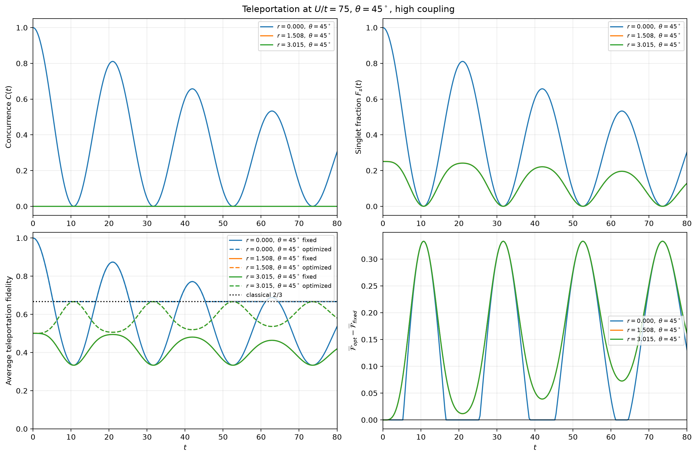

# Quantum Teleportation and Dense Coding in Open Quantum Systems

**Python simulations of BdG Cooper-pair correlations, two-qubit entanglement,
explicit quantum teleportation, and dense-coding-related information measures
under non-Markovian noise.**

[](https://www.python.org/)
[](https://numpy.org/)
[](https://scipy.org/)
[](LICENSE)

This research codebase connects a **Hubbard/Bogoliubov–de Gennes (BdG) model**
to **open-quantum-system dynamics**. It solves the BdG self-consistency
equations, calculates equal-time Green's functions, constructs two-spin density
matrices, evolves them with Kraus operators, and evaluates entanglement,
teleportation fidelity, fidelity, entropy, and a Pauli-ensemble Holevo quantity.

> **Scope:** this is a numerical research model, not an experimental demonstration.
> The teleportation input is an effective spin qubit, and Bell measurement and
> classical feedforward are idealized operations.

## Contents

- [Features](#features)
- [Simulation pipeline](#simulation-pipeline)
- [Installation](#installation)
- [Quick start](#quick-start)
- [Explicit quantum teleportation](#explicit-quantum-teleportation)
- [Validation and reproducibility](#validation-and-reproducibility)
- [Configuration](#configuration)
- [Outputs and figures](#outputs-and-figures)
- [Scientific conventions](#scientific-conventions)
- [Repository map](#repository-map)
- [Limitations](#limitations)
- [Citation and license](#citation-and-license)

## Features

- **BdG self-consistency:** solve for gap parameters and chemical potential on a
  two-dimensional momentum grid using SciPy.
- **Spatial correlations:** calculate normal and anomalous equal-time Green's
  functions over distance and angle.
- **Two-qubit states:** build and check Hermitian, normalized,
  positive-semidefinite X-state density matrices.
- **Open-system dynamics:** apply independent amplitude damping, independent
  Ornstein–Uhlenbeck dephasing, or common-bath dephasing.
- **Entanglement observables:** concurrence, singlet fraction, purity, and von
  Neumann entropy over distance and time.
- **Explicit teleportation:** Bell measurement, outcome probabilities,
  conditional output states, Pauli feedforward, and six-state average fidelity.
- **Teleportation optimization:** exact fully entangled fraction from singular
  values of the Pauli correlation matrix, plus locally optimized fidelity.
- **Dense-coding-related analysis:** Holevo quantity for the implemented
  equal-probability Pauli encoding ensemble.
- **Reproducible outputs:** compressed NumPy arrays, figures, JSON diagnostics,
  validation scripts, and a manuscript.

## Simulation pipeline

```text
BdG self-consistency
        ↓
Normal and anomalous Green's functions G(r,θ), F(r,θ)
        ↓
Two-spin density matrices ρAB(r,θ)
        ↓
Non-Markovian Kraus evolution ρAB(r,θ,t)
        ↓
Entanglement · fidelity · entropy · Holevo quantity · teleportation
        ↓
NPZ data + PNG figures + JSON validation reports
```

### Example: teleportation under high-noise evolution

The plot below compares distance-dependent concurrence, singlet fraction,
fixed-protocol average teleportation fidelity, fully entangled fraction, and
locally optimized average fidelity. The dashed line marks the classical
average-fidelity benchmark \(2/3\).



The arrays and assumptions behind this figure are documented in
[`reports/teleportation_report.md`](reports/teleportation_report.md) and
[`reports/teleportation_analysis_summary.json`](reports/teleportation_analysis_summary.json).

## Installation

### Requirements

- Python 3.10 or newer is recommended.
- NumPy, SciPy, and Matplotlib.

### Clone and create an environment

```bash
git clone https://github.com/AmirhoseynpowAsghari/quantum-teleportation-and-dense-coding-in-open-quantum-systems.git
cd quantum-teleportation-and-dense-coding-in-open-quantum-systems

python -m venv .venv
source .venv/bin/activate          # Linux/macOS
# .venv\Scripts\activate           # Windows PowerShell

python -m pip install --upgrade pip
python -m pip install numpy scipy matplotlib
```

No additional quantum-computing package is required.

## Quick start

Run the complete BdG and open-system pipeline without opening plot windows:

```bash
python main.py --no-plot
```

Generate plots for independent non-Markovian amplitude damping:

```bash
python main.py --kind amp --bath independent --plot
```

Run independent or common-bath dephasing:

```bash
python main.py --kind dephasing --bath independent --plot
python main.py --kind dephasing --bath common --plot
```

Override the noise parameters and choose an output prefix:

```bash
python main.py \
  --kind amp \
  --bath independent \
  --gammaA 4.5 --GammaA 0.01 \
  --gammaB 4.5 --GammaB 0.01 \
  --theta 3 \
  --seed 42 \
  --prefix my_run \
  --plot
```

Here lowercase `gamma` and uppercase `Gamma` are distinct channel parameters;
they are not interchangeable. Common-bath evolution is supported for
**dephasing only**.

> **Preserve bundled results:** `main.py` writes the fixed filenames
> `data/rho_rt_results.npz` and `data/C_rt_heatmap.npz`. Before rerunning,
> copy any results you want to preserve or change `OUT_RHO` and `OUT_HEATMAP`
> in `config.py`. The `--prefix` option does not rename those two fixed files.

## Explicit quantum teleportation

`teleportation.py` implements the complete effective-qubit protocol rather than
using entanglement as a proxy for teleportation:

1. Prepare an arbitrary pure input state on spin Q.
2. Form \(\rho_Q\otimes\rho_{AB}\).
3. Apply four Bell projectors to Q and A.
4. Record each probability and conditionally normalized output on B.
5. Apply the corresponding Pauli correction after classical communication.
6. Calculate input–output Uhlmann fidelity and its six-cardinal-state average.

For a resource \(\rho_{AB}\), the module separately reports concurrence,
singlet-reference fidelity, fixed-protocol average fidelity, fully entangled
fraction, and locally optimized average fidelity. The optimization uses an
exact SVD formula, not a numerical optimizer.

Run the validation and BdG-resource analysis:

```bash
python analysis/validate_teleportation.py
python analysis/run_teleportation_analysis.py
```

The deterministic validation suite contains **65 checks**, including ideal
singlets, maximally mixed resources, Werner states, a pure product resource,
Bell-outcome probabilities, feedforward, positivity, and trace preservation.
The analysis exports full time arrays to `data/teleportation_metrics.npz` and
figures to `figs/`.

### Minimal Python example

```python
import numpy as np
from teleportation import (
    average_teleportation_fidelity,
    optimized_teleportation_fidelity,
    singlet_state,
)

singlet = np.outer(singlet_state(), singlet_state().conj())
fixed = average_teleportation_fidelity(singlet)
optimized = optimized_teleportation_fidelity(singlet)

print(f"Fixed six-state average fidelity: {fixed['average_fidelity']:.6f}")
print(f"Optimized average fidelity:       {optimized:.6f}")
```

Expected result for the ideal singlet: both fidelities are `1.000000` up to
floating-point precision.

## Validation and reproducibility

Available validation and reproduction entry points:

| Command | Purpose |
|---|---|
| `python analysis/validate_teleportation.py` | Bell measurement, feedforward, average fidelity, Werner limits, and output-state diagnostics |
| `python analysis/validate_density_matrix_scope.py` | Density-matrix validity and scope checks |
| `python analysis/reproduce_and_validate.py` | Reproduce archived numerical results and compare observables |
| `python analysis/compare_equal_time_greens.py` | Compare corrected equal-time and explicitly selected legacy Green's-function conventions |

Useful evidence files:

- [`reports/teleportation_validation.json`](reports/teleportation_validation.json)
- [`reports/teleportation_report.md`](reports/teleportation_report.md)
- [`reports/numerical_validation.json`](reports/numerical_validation.json)
- [`reports/evidence_and_reproducibility.md`](reports/evidence_and_reproducibility.md)
- [`reports/density_matrix_validity_report.md`](reports/density_matrix_validity_report.md)

For a reproducible run, record the Git commit, complete `config.py`, command
line, and package versions:

```bash
git rev-parse HEAD
python --version
python -m pip freeze
```

The specialized analysis scripts may override the defaults in `config.py`;
their exported JSON/NPZ metadata is the authoritative record for those runs.

## Configuration

Edit [`config.py`](config.py) to change the physical model and numerical grids.
Current defaults include:

| Parameter | Default | Meaning |
|---|---:|---|
| `t_hop` | `1.0` | Energy scale |
| `U / t_hop` | `75` | Hubbard interaction |
| `Delta_t` | `4.5` | Model parameter in the BdG kernel |
| `V_SO` | `0.0` | Spin–orbit-coupling parameter |
| `n_elec` | `1.875` | Electron filling |
| `Nk` | `100` | Momentum-grid dimension |
| `R_MIN, R_MAX, N_R` | `0, 10, 200` | Real-space grid |
| `T_MIN, T_MAX, N_T` | `0, 80, 261` | Time grid |
| `GAMMA_A, GAMMA_B` | `1.5` | Amplitude-damping parameters |
| `BIG_GAMMA_A, BIG_GAMMA_B` | `0.1` | Reservoir-width parameters |

For a faster smoke test, reduce `Nk`, `N_R`, and `N_T` in `config.py`, for
example to `30`, `40`, and `41`. Do not use a reduced grid as a substitute for
convergence testing in a production calculation.

## Outputs and figures

The main pipeline writes compressed NumPy arrays:

```text
data/rho_rt_results.npz
data/C_rt_heatmap.npz
```

`rho_rt_results.npz` includes the time grid, radial and angular grids,
concurrence, singlet fraction, purity, entropy, noise settings, and BdG
solution metadata.

```python
import numpy as np

results = np.load("data/rho_rt_results.npz")
r = results["r_vals"]
t = results["t_grid"]
concurrence = results["C_rt"]
singlet_fraction = results["Fs_rt"]

print(concurrence.shape)       # (N_R, N_T)
print(concurrence.max())
```

Output directories have distinct roles:

- `data/`: bundled and generated NPZ numerical arrays.
- `figures/`: figures from the main visualization modules.
- `figs/`: specialized validation, comparison, and teleportation figures.
- `reports/`: reproducibility records, diagnostics, and scientific reports.

## Scientific conventions

### Equal-time Green's functions

`compute_greens_functions` defaults to `convention="equal_time"`, the
zero-temperature equal-time branch used for the two-spin reduction. At
`V_SO=0`, the common factor `1/2` averages the two degenerate helicity
contributions; it gives `G(0)=n/2` and cancels from normalized correlators.

The previous implementation remains available only through the explicit
`convention="legacy_unsigned"` option for comparison with archived arrays.
New calculations should not silently mix legacy and corrected results. See
[`reports/equal_time_greens_comparison.md`](reports/equal_time_greens_comparison.md).

### Fidelity and teleportation are not interchangeable

The code distinguishes:

- squared Uhlmann fidelity to the initial state;
- squared Uhlmann fidelity to a pure reference state;
- singlet fraction;
- fixed singlet-reference teleportation fidelity;
- fully entangled fraction;
- local-unitary-optimized teleportation fidelity.

For a Werner state with weight \(w\), the validated identities are

\[
\overline{\mathcal F}=\frac{1+w}{2},\qquad
F_s=\mathfrak f=\frac{1+3w}{4}.
\]

The Werner weight \(w\) itself is not the singlet fraction.

### Holevo quantity

`holevo.py` evaluates

\[
\chi=S(\widetilde\rho_{AB})-S(\rho_{AB}),\qquad
\widetilde\rho_{AB}=\frac14\sum_{i=0}^{3}
(\sigma_i\otimes I)\rho_{AB}(\sigma_i\otimes I)^\dagger,
\]

using base-2 entropies. This is the Holevo quantity of the implemented Pauli
ensemble; it is not automatically the dense-coding capacity, accessible
information, or an experimentally achieved communication rate.

## Repository map

| Path | Role |
|---|---|
| `main.py` | End-to-end simulation runner |
| `config.py` | Model, grids, noise, and output configuration |
| `self_consistency.py` | BdG self-consistency solver |
| `greens_functions.py` | Equal-time and legacy Green's-function conventions |
| `density_matrix.py` | Two-qubit X-state construction and physical checks |
| `noise_channels.py`, `evolution.py` | Kraus operators and open-system evolution |
| `observables.py` | Concurrence, singlet fraction, purity, and entropy |
| `fidelity.py` | Uhlmann fidelity calculations and grids |
| `holevo.py` | Pauli-ensemble Holevo analysis |
| `teleportation.py` | Explicit Bell-measurement teleportation protocol |
| `analysis/` | Validation, reproduction, and specialized analysis scripts |
| `manuscript.tex`, `manuscript.pdf` | Research manuscript source and compiled document |

## Limitations

- Q is an effective input spin, not automatically a physical Bogoliubov
  quasiparticle.
- Teleportation assumes independently addressable A/B spin modes, ideal Bell
  measurement, and ideal classical feedforward.
- The code does not establish microscopic quasiparticle–Cooper-pair coupling,
  individual Cooper-pair addressability, or experimental Bell detection.
- Local amplitude damping is angle-independent in the implemented model;
  initial-state angular dependence should not be confused with an angular
  environmental coupling.
- Fixed-\(U\) runs do not establish interaction-strength trends. BdG solver
  convergence and grid convergence must be checked for each parameter regime.
- Nonmonotonic dynamics alone do not establish information backflow.
- Concurrence, singlet fraction, teleportation fidelity, and the Holevo
  quantity are distinct measures and should not be substituted for one another.

## Contributing

Issues and pull requests are welcome. For numerical changes, include the
command used, parameter values, relevant diagnostics, and—where applicable—a
comparison against an analytic limit or archived result. Please avoid
overwriting bundled evidence files when adding new runs.

## Citation and license

If this code contributes to a publication, thesis, or report, cite the
repository and include the commit hash used for the simulations:

```bibtex
@software{asghari_quantum_open_systems,
  title  = {Quantum Teleportation and Dense Coding in Open Quantum Systems},
  author = {Asghari, Amirhoseyn},
  url    = {https://github.com/AmirhoseynpowAsghari/quantum-teleportation-and-dense-coding-in-open-quantum-systems},
  year   = {2026},
  note   = {Include the Git commit hash for reproducibility}
}
```

Released under the [MIT License](LICENSE).
