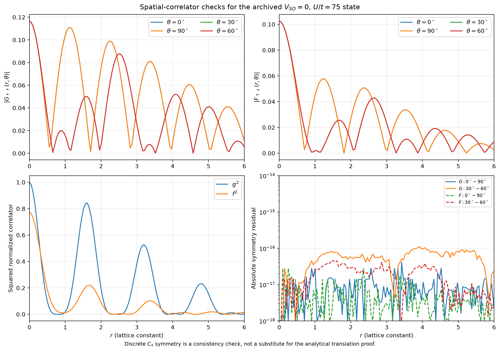
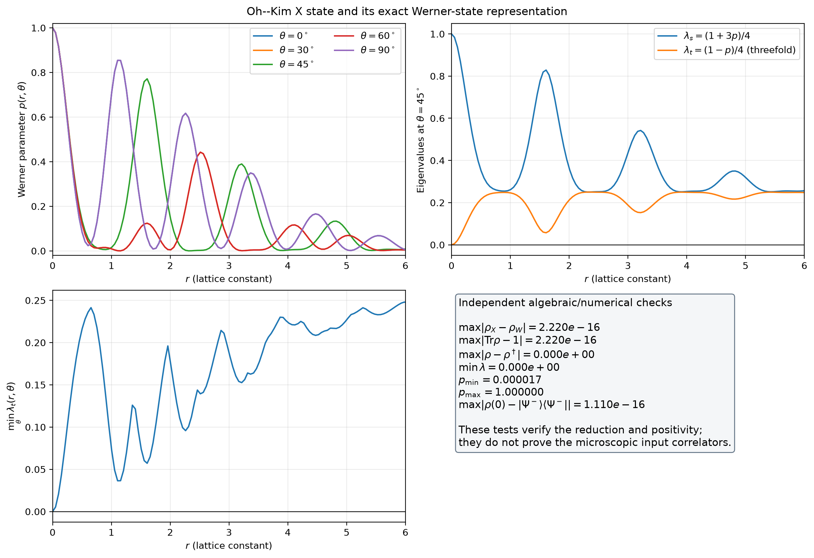
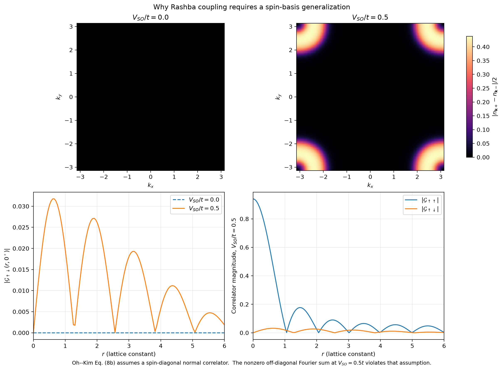
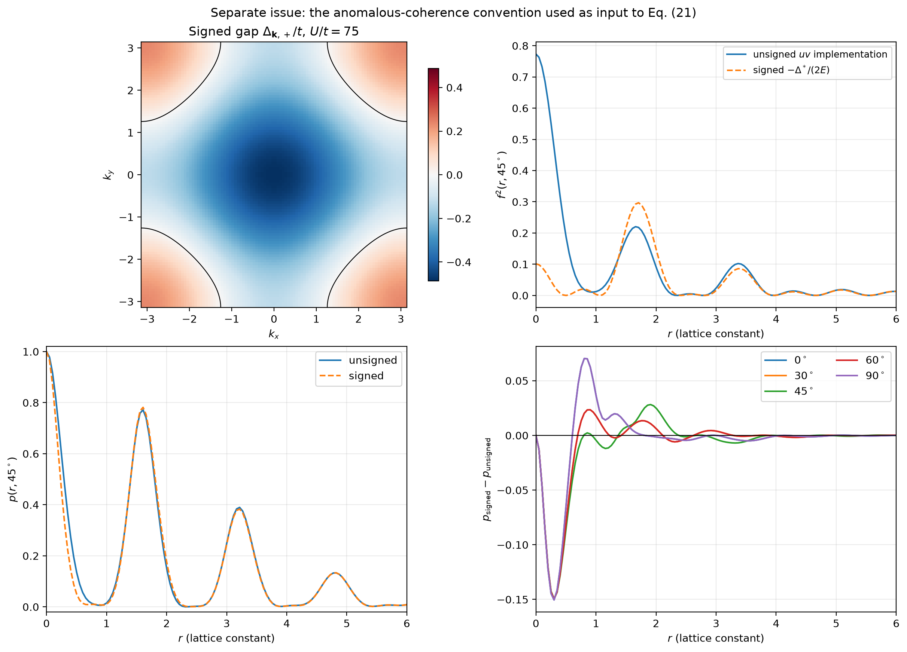

# Applicability of the Oh–Kim two-spin density matrix to the Hubbard–Rashba BdG model

**Scientific assessment of Eq. (19) of Oh and Kim, `quant-ph/0406013`, for the model of Hutchinson, Hirsch, and Marsiglio, `arXiv:1801.08988`**

**Repository state analyzed:** `dc7f25fc3757077a2a764fadbd726f27da4b6d4d`

**Numerical archived case:** \(U/t=75\), \(\Delta_t/t=4.5\), \(V_{\mathrm{SO}}=0\), \(n=1.875\), \(N_k=100\), \(T=0\)

## Abstract

The Oh–Kim two-spin density matrix is applicable to the archived zero-spin-orbit-coupling calculation, but **translational invariance alone is not a sufficient justification**. The required assumptions are: a spatially uniform lattice state, pairing at zero center-of-mass momentum, a Gaussian BdG mean-field state for which Wick factorization holds, a spin-diagonal normal correlator, a spin-singlet anomalous correlator, and normalization conditional on detecting one electron at each of two positions. The uniform Hutchinson–Hirsch–Marsiglio Hamiltonian and its zero-momentum BdG mean field satisfy the first three assumptions. In the limit \(V_{\mathrm{SO}}=0\), the original spin basis also satisfies the spin-diagonal and singlet assumptions. Momentum dependence or a sign change of the extended-\(s\)-wave gap, and direction dependence on a square lattice, do not break translational invariance.

The same matrix cannot be applied without generalization to physical spin qubits in the full Rashba model at \(V_{\mathrm{SO}}\neq0\). Hutchinson *et al.* explicitly find mixed singlet–triplet pairing, and a direct helicity-to-spin transformation produces spin-off-diagonal normal correlations. A separate numerical issue remains in the repository: the archived anomalous correlator uses non-negative coherence amplitudes \(u_{\mathbf ks}v_{\mathbf ks}\), whereas the BdG identity contains the signed factor \(-\Delta_{\mathbf ks}^*/(2E_{\mathbf ks})\). This issue concerns the **inputs** to the Oh–Kim matrix, not the validity of the matrix algebra itself.

## 1. Short answer

The most defensible answer to give is:

> I use the Oh–Kim reduction only for the spatially uniform, zero-center-of-mass-momentum BdG mean-field state at \(V_{\mathrm{SO}}=0\). In that limit the normal Green function is spin diagonal and the anomalous Green function is an even-parity spin singlet. Together with Wick factorization and conditional two-electron normalization, these assumptions yield Oh–Kim Eqs. (19)–(23), including for a momentum-dependent extended-\(s\)-wave gap. I do not claim that the same expression directly describes original-spin qubits at nonzero Rashba coupling.

Thus, **you can use the density matrix for your present archived \(V_{\mathrm{SO}}=0\) model**, subject to the anomalous-coherence correction discussed in Sec. 8. It would be incorrect to defend it solely by saying “the Hamiltonian is translational invariant,” and it would be incorrect to apply it unchanged to the full Rashba spin state.

## 2. What Oh and Kim actually assume

Oh and Kim, *Entanglement of electron spins in superconductors*, derive the two-electron density matrix from a two-particle Green function. Their derivation uses the following assumptions:

1. **Gaussian BCS state.** Their Eq. (7) factorizes the two-particle Green function into normal and anomalous one-particle Green functions. This is Wick's theorem for the BCS/BdG mean-field state, not an identity for an arbitrary exact interacting Hubbard ground state.
2. **Spin-diagonal normal propagation.** Their Eqs. (8a)–(8b) take
   \[
   G_{ss'}(\mathbf r,\mathbf r')\propto\delta_{ss'}G(\mathbf r-\mathbf r').
   \]
3. **Singlet anomalous propagation.** Their Eqs. (9a)–(9c) take the spin structure to be \(I_{ss'}=i\sigma_y\), i.e. an antisymmetric spin singlet.
4. **Translational invariance.** Their discussion before Eqs. (10)–(13) uses \(G(\mathbf r_1,\mathbf r_1')=G(\mathbf r_1-\mathbf r_1')\) and \(F(\mathbf r_1,\mathbf r_2)=F(\mathbf r_1-\mathbf r_2)\).
5. **Diagonal spatial detection.** Their Eq. (19) sets \(\mathbf r_1=\mathbf r_1'\) and \(\mathbf r_2=\mathbf r_2'\). This describes one electron detected at each of two fixed locations, not the complete two-electron orbital density matrix.
6. **Conditional spin normalization.** Their Eqs. (20)–(21) divide by the probability weight of that two-electron detection sector to obtain a normalized two-spin state.

Source: [Oh and Kim, quant-ph/0406013, especially Eqs. (7)–(10) and (17)–(23)](https://arxiv.org/pdf/quant-ph/0406013). **VERIFIED from the cited source.**

## 3. Proof of translational invariance for the base model

### 3.1 Uniform lattice Hamiltonian

Let \(T_{\mathbf a}\) translate every lattice site by a lattice vector \(\mathbf a\):
\[
T_{\mathbf a}c_{i\sigma}T_{\mathbf a}^{-1}=c_{i+\mathbf a,\sigma}.
\]
The normal hopping in Hutchinson *et al.* Eq. (2) is a sum over identical nearest-neighbor bonds, the Hubbard interaction has a site-independent \(U\), and the correlated-hopping coefficient \(\Delta t\) is also site independent. The Rashba term in their Eqs. (3)–(7) has the same oriented bond structure at every site. Therefore, for an infinite lattice or periodic boundary conditions,
\[
T_{\mathbf a}HT_{\mathbf a}^{-1}=H.
\]
Rashba spin-orbit coupling can break inversion or spin-rotation symmetry without breaking discrete lattice translations. These are distinct symmetries.

### 3.2 Zero-center-of-mass-momentum pairing preserves translations

The mean-field pairing retained by Hutchinson *et al.* has the form
\[
c_{\mathbf k\alpha}^{\dagger}c_{-\mathbf k\beta}^{\dagger},
\]
with zero total pair momentum; see their Eqs. (14) and (19)–(22). Using
\[
c_{j\sigma}=\frac1{\sqrt N}\sum_{\mathbf k}e^{i\mathbf k\cdot\mathbf R_j}c_{\mathbf k\sigma},
\]
the normal equal-time correlator becomes
\[
\begin{aligned}
\langle c_{i\sigma}^{\dagger}c_{j\sigma}\rangle
&=\frac1N\sum_{\mathbf k,\mathbf k'}
e^{-i\mathbf k\cdot\mathbf R_i+i\mathbf k'\cdot\mathbf R_j}
\langle c_{\mathbf k\sigma}^{\dagger}c_{\mathbf k'\sigma}\rangle\\
&=\frac1N\sum_{\mathbf k}
e^{i\mathbf k\cdot(\mathbf R_j-\mathbf R_i)}n_{\mathbf k\sigma}
=G_\sigma(\mathbf R_j-\mathbf R_i).
\end{aligned}
\]
Similarly, zero-momentum pairing gives
\[
\langle c_{i\uparrow}c_{j\downarrow}\rangle
=\frac1N\sum_{\mathbf k}e^{i\mathbf k\cdot(\mathbf R_i-\mathbf R_j)}
\langle c_{\mathbf k\uparrow}c_{-\mathbf k\downarrow}\rangle
=F_{\uparrow\downarrow}(\mathbf R_i-\mathbf R_j).
\]
A simultaneous shift \(\mathbf R_i\rightarrow\mathbf R_i+\mathbf a\), \(\mathbf R_j\rightarrow\mathbf R_j+\mathbf a\) leaves both expressions unchanged. **DERIVED.**

### 3.3 Momentum-dependent and sign-changing gaps are allowed

Nothing in this proof requires \(\Delta_{\mathbf k}\) to be constant or positive. A gap
\[
\Delta_{\mathbf ks}=\Delta_0-\frac{\Delta_s}{4t}\epsilon_{\mathbf ks}
\]
is a function of relative crystal momentum. It does not introduce a position-dependent potential or finite pair momentum. Its sign changes modify \(F(\mathbf r)\), but do not invalidate \(F(\mathbf R_1,\mathbf R_2)=F(\mathbf R_1-\mathbf R_2)\).

Likewise, a square lattice is not continuously rotationally invariant. Consequently \(G\) and \(F\) may depend on the direction of \(\mathbf r\). Oh–Kim Eq. (19) can be read with a vector separation \(\mathbf r\); no continuous rotational symmetry is required for the algebraic reduction.

**Qualification:** open boundaries, impurities, position-dependent mean fields, FFLO/finite-momentum pairing, or another spontaneously translation-broken order would require a two-position correlator \(G(\mathbf R_1,\mathbf R_2)\), not merely \(G(\mathbf R_1-\mathbf R_2)\). A finite Brillouin-zone quadrature grid is not, by itself, an open-boundary real-space model.

## 4. From Wick factorization to the Oh–Kim matrix

For a quadratic BdG Hamiltonian, the equal-time two-electron contraction has the generic Wick structure
\[
\begin{aligned}
\langle c_{2'}^{\dagger}c_{1'}^{\dagger}c_1c_2\rangle
={}&\langle c_{2'}^{\dagger}c_2\rangle\langle c_{1'}^{\dagger}c_1\rangle
-\langle c_{2'}^{\dagger}c_1\rangle\langle c_{1'}^{\dagger}c_2\rangle\\
&+\langle c_{2'}^{\dagger}c_{1'}^{\dagger}\rangle\langle c_1c_2\rangle .
\end{aligned}
\]
At the two detected positions, translational invariance reduces the normal factors to \(G(0)\), \(G(\mathbf r)\), and \(G(-\mathbf r)\), while the anomalous factor contains \(F(\mathbf r)F^*(\mathbf r)\). With the spin structures listed in Sec. 2, this is precisely Oh–Kim Eq. (19).

Define normalized scalar correlators
\[
g(\mathbf r)=\frac{G(\mathbf r)}{G(0)},\qquad
f(\mathbf r)=\frac{F(\mathbf r)}{G(0)},
\]
and write \(g^2=|g(\mathbf r)|^2\), \(f^2=|f(\mathbf r)|^2\). After conditional normalization, Oh–Kim Eq. (21) is
\[
\rho_X(\mathbf r)=\frac1{\mathcal N}
\begin{pmatrix}
1-g^2&0&0&0\\
0&1+f^2&-(g^2+f^2)&0\\
0&-(g^2+f^2)&1+f^2&0\\
0&0&0&1-g^2
\end{pmatrix},
\]
\[
\mathcal N=4-2g^2+2f^2.
\]
The momentum dependence of the underlying band structure enters only through \(g\) and \(f\); it does not change this spin algebra. **DERIVED from the cited Oh–Kim contraction.**

## 5. Algebraic proof of the Werner form and positivity

Define
\[
p=\frac{f^2+g^2}{2+f^2-g^2},\qquad
|\Psi^-\rangle=\frac{|\uparrow\downarrow\rangle-|\downarrow\uparrow\rangle}{\sqrt2}.
\]
Direct expansion proves the identity
\[
\rho_X=(1-p)\frac{\mathbb I_4}{4}+p|\Psi^-\rangle\langle\Psi^-|.
\tag{A}
\]
The eigenvalues are
\[
\lambda_s=\frac{1+3p}{4}\quad\text{(singlet)},\qquad
\lambda_t=\frac{1-p}{4}\quad\text{(threefold)}.
\]
Equivalently, in terms of \(g,f\),
\[
\lambda_t=\frac{1-g^2}{\mathcal N},\qquad
\lambda_s=\frac{1+g^2+2f^2}{\mathcal N}.
\]
Because \(G(\mathbf r)\) is a normalized weighted sum of phases,
\[
|g(\mathbf r)|
=\left|\frac{\sum_{\mathbf k}w_{\mathbf k}e^{i\mathbf k\cdot\mathbf r}}
{\sum_{\mathbf k}w_{\mathbf k}}\right|\leq1,
\qquad w_{\mathbf k}\geq0.
\]
Hence \(g^2\leq1\), \(\mathcal N\geq2+2f^2>0\), \(\lambda_t\geq0\), and \(0\leq p\leq1\). The normalized conditional matrix is therefore Hermitian, unit trace, and positive semidefinite. At \(\mathbf r=0\), \(g=1\), so \(p=1\) and
\[
\rho_X(0)=|\Psi^-\rangle\langle\Psi^-|,
\]
independently of \(f(0)\). **DERIVED.**

These results prove the consistency of the matrix form; they do not independently prove that a particular numerical implementation has calculated \(G\) and \(F\) correctly.

## 6. Assumption-by-assumption application to this repository

| Requirement | Assessment for the archived calculation | Evidence |
|---|---|---|
| Uniform square-lattice Hamiltonian | Satisfied for the stated infinite/periodic bulk model | **VERIFIED:** base Hamiltonian; `kspace_setup.py`; `self_consistency.py` |
| Zero total pair momentum | Satisfied by the BdG mean-field ansatz | **VERIFIED:** Hutchinson *et al.* Eqs. (14), (19)–(22) |
| Gaussian state and Wick factorization | Satisfied within BdG mean-field theory, not for an exact non-Gaussian Hubbard treatment | **VERIFIED/DERIVED:** mean-field decoupling in base paper |
| Spin-diagonal normal correlator | Satisfied at \(V_{\mathrm{SO}}=0\) | **VERIFIED:** `config.py`; degenerate helicity branches |
| Singlet anomalous spin structure | Satisfied at \(V_{\mathrm{SO}}=0\) for the even extended-\(s\)-wave pair | **DERIVED:** zero Rashba mixing restores the original spin basis |
| Relative-coordinate correlators | Satisfied by the Fourier construction | **VERIFIED:** `greens_functions.py`; proof in Sec. 3 |
| Conditional two-location spin state | Matches the intended Oh–Kim construction | **VERIFIED:** `density_matrix.py` implements Eqs. (20)–(21) |
| Valid at nonzero Rashba coupling in the original spin basis | **Not established; generally false without generalization** | **DERIVED + NUMERICAL COUNTERCHECK:** Sec. 7 |
| Exact signed BdG anomalous input | **Not satisfied by the archived unsigned-amplitude implementation when the gap changes sign** | **VERIFIED + NUMERICAL COMPARISON:** Sec. 8 |

The base source is [Hutchinson, Hirsch, and Marsiglio, arXiv:1801.08988](https://arxiv.org/pdf/1801.08988). Their Eq. (31) and surrounding discussion explicitly state that the gap is mixed singlet–triplet in the presence of spin-orbit coupling.

## 7. Numerical checks and figures

### 7.1 Spatial correlators and lattice symmetry



**Figure 1.** Archived \(V_{\mathrm{SO}}=0\), \(U/t=75\) normal and anomalous correlators. Directions related by square-lattice symmetry overlap. The maximum absolute residuals are
\[
\begin{array}{c|c}
\text{comparison}&\text{maximum absolute residual}\\
\hline
G(0^\circ)-G(90^\circ)&4.1695\times10^{-17}\\
G(30^\circ)-G(60^\circ)&1.1124\times10^{-16}\\
F(0^\circ)-F(90^\circ)&2.7845\times10^{-17}\\
F(30^\circ)-F(60^\circ)&4.5431\times10^{-17}
\end{array}
\]
These are **NUMERICAL CONSISTENCY CHECKS**, not replacements for the analytical translation proof. Direction dependence between inequivalent angles is allowed.

### 7.2 Exact Werner equivalence and positivity



**Figure 2.** Werner parameter and eigenvalues constructed from the archived correlators. Across all seven angles and 200 separations, the checks give
\[
\max|\rho_X-\rho_W|=2.2204\times10^{-16},\qquad
\max|\operatorname{Tr}\rho-1|=2.2204\times10^{-16},
\]
\[
\max|\rho-\rho^\dagger|=0,\qquad
\min\lambda=0,
\]
where the zero minimum is attained by the pure singlet at \(r=0\), not by a negative eigenvalue. The observed range is \(1.6806\times10^{-5}\leq p\leq1\), and
\[
\max|\rho(0)-|\Psi^-\rangle\langle\Psi^-||=1.1102\times10^{-16}.
\]
These values are **VERIFIED NUMERICAL OUTPUT** in `reports/density_matrix_validity_checks.json`.

### 7.3 Why the full Rashba case needs a different derivation

Hutchinson *et al.* define helicity operators by
\[
c_{\mathbf ks}^{\dagger}
=\frac{c_{\mathbf k\uparrow}^{\dagger}+se^{i\theta_{\mathbf k}}c_{\mathbf k\downarrow}^{\dagger}}{\sqrt2}.
\]
Inverting this relation gives
\[
c_{\mathbf k\uparrow}=\frac{c_{\mathbf k+}+c_{\mathbf k-}}{\sqrt2},\qquad
c_{\mathbf k\downarrow}=e^{i\theta_{\mathbf k}}\frac{c_{\mathbf k+}-c_{\mathbf k-}}{\sqrt2}.
\]
For \(n_{\mathbf ks}=\langle c_{\mathbf ks}^{\dagger}c_{\mathbf ks}\rangle\), the original-spin off-diagonal coefficient is therefore
\[
\langle c_{\mathbf k\uparrow}^{\dagger}c_{\mathbf k\downarrow}\rangle
=\frac{e^{i\theta_{\mathbf k}}}{2}(n_{\mathbf k+}-n_{\mathbf k-}).
\tag{B}
\]
At \(V_{\mathrm{SO}}=0\), the branches are degenerate and this quantity vanishes. At nonzero Rashba coupling it need not vanish. Its spatial Fourier sum was evaluated independently along the \(x\) direction.



**Figure 3.** Original-spin normal-correlator diagnostic. The \(V_{\mathrm{SO}}=0.5t\), \(U/t=75\) control solution converged with maximum residual \(3.526\times10^{-12}\). It gives
\[
\max_r|\mathcal G_{\uparrow\downarrow}(r,0^\circ)|=0.0317533,
\]
whereas the corresponding result is exactly zero at \(V_{\mathrm{SO}}=0\). This directly violates Oh–Kim's spin-diagonal assumption in Eq. (8b). In addition, the base paper states that its Rashba pairing is mixed singlet–triplet. Consequently, **translational invariance survives Rashba coupling, but the simple Oh–Kim spin reduction does not automatically survive it**.

A nonzero-\(V_{\mathrm{SO}}\) treatment must either construct the full spin-resolved \(4\times4\) Nambu correlator and derive a generalized two-spin state, or explicitly define helicity pseudospin qubits and justify the different operational meaning.

## 8. Separate issue: signed anomalous coherence

For the BdG convention stated in the manuscript,
\[
u_{\mathbf ks}v_{\mathbf ks}^*
=-\frac{\Delta_{\mathbf ks}^*}{2E_{\mathbf ks}}.
\tag{C}
\]
The archived `self_consistency.py` instead constructs \(u_{\mathbf ks}\) and \(v_{\mathbf ks}\) as non-negative square roots, and `greens_functions.py` multiplies those non-negative amplitudes. When \(\Delta_{\mathbf ks}\) changes sign, this is not generally equal to Eq. (C) before Brillouin-zone integration.

A separate comparison was therefore performed using the same archived normal \(G\), momentum grid, and quadrature, but replacing only the anomalous coherence by Eq. (C).



**Figure 4.** Effect of retaining the gap sign in the anomalous input at \(U/t=75\), \(V_{\mathrm{SO}}=0\). The top-left panel shows that the gap changes sign. The remaining panels compare the squared normalized anomalous correlator and Werner parameter. Over the complete angular/radial grid,
\[
\max|F_{\mathrm{signed}}-F_{\mathrm{archived}}|=0.1395489,
\qquad
\max|p_{\mathrm{signed}}-p_{\mathrm{unsigned}}|=0.1504256.
\]
The signed-input matrices remain positive and normalized. These are **VERIFIED NEW NUMERICAL RESULTS**, not modifications silently applied to the archived manuscript arrays.

The interpretation is precise:

- This discrepancy **does not invalidate Oh–Kim Eqs. (19)–(23)**.
- It does mean that the current archived numerical values cannot be defended as the exact signed-BdG results until the anomalous input is corrected or the unsigned approximation is independently justified.
- The next scientific step is to regenerate the observables with Eq. (C) and compare the signed and unsigned results, rather than changing the density-matrix formula.

## 9. What the figures prove—and what they do not

### Established by analytical derivation

1. Uniform zero-momentum pairing yields relative-coordinate \(G\) and \(F\).
2. Momentum dependence and gap sign changes do not break translational invariance.
3. Gaussian factorization plus spin-diagonal normal and singlet anomalous correlators yields Oh–Kim Eq. (19).
4. The normalized matrix is exactly a Werner state and is positive for \(|g|\leq1\).
5. At \(r=0\), it is exactly the singlet.

### Established by numerical checks

1. The archived arrays respect the expected square-lattice symmetry to floating-point precision.
2. The implemented X matrix and independently constructed Werner matrix agree to machine precision.
3. All tested matrices are Hermitian, normalized, and positive semidefinite.
4. A nonzero-Rashba control calculation produces original-spin off-diagonal normal correlations.
5. Retaining the signed gap changes the anomalous input appreciably for the tested \(U/t=75\) state.

### Not established

1. Applicability of the unchanged matrix to original-spin qubits at \(V_{\mathrm{SO}}\neq0\).
2. Exactness for an interacting state beyond Gaussian BdG mean-field theory.
3. Applicability to open boundaries, impurities, position-dependent pairing, or finite-momentum pairing.
4. Correctness of the archived unsigned anomalous correlator as an exact signed-BdG result.
5. A canonical fixed-electron-number reduction beyond the conditional two-detection normalization used by Oh and Kim.

## 10. Manuscript-ready justification paragraph

> In the zero-spin-orbit-coupling limit considered in the numerical calculations, the two helicity branches are degenerate and the original spin basis is restored. The spatially uniform BdG mean-field Hamiltonian contains only zero-center-of-mass-momentum pairs, so the equal-time normal and anomalous correlators depend on the relative coordinate \(\mathbf r=\mathbf R_1-\mathbf R_2\). Because the BdG state is Gaussian, its two-particle contraction factorizes by Wick's theorem. The normal correlator is spin diagonal and the even-parity anomalous correlator has singlet spin structure. Conditioning on one electron detected at each position and normalizing the resulting two-spin sector therefore yields the Oh–Kim matrix, Eqs. (19)–(23) of Ref. [Oh–Kim], including for the momentum-dependent extended-\(s\)-wave gap. This reduction is not used for original-spin qubits at nonzero Rashba coupling, where spin-off-diagonal normal correlations and mixed singlet–triplet pairing require a generalized spin-resolved construction. The anomalous spatial input is evaluated using the signed BdG coherence factor \(u_{\mathbf k}v_{\mathbf k}^*=-\Delta_{\mathbf k}^*/(2E_{\mathbf k})\).

The last sentence should be included only after the numerical pipeline actually uses the signed factor.

## 11. Reproducibility

Run from the repository root:

```bash
.venv/bin/python analysis/validate_density_matrix_scope.py
```

Generated artifacts:

- `reports/density_matrix_validity_checks.json` — numerical metrics and solver residuals;
- `reports/density_matrix_validity_stdout.txt` — execution output;
- `data/density_matrix_validity_checks.npz` — arrays used in the four figures;
- `figs/density_matrix_spatial_checks.png`;
- `figs/density_matrix_werner_validation.png`;
- `figs/density_matrix_rashba_scope.png`;
- `figs/density_matrix_coherence_convention.png`.

No IBM hardware or external numerical results were used. The nonzero-Rashba example is a newly executed control calculation, not part of the archived manuscript sweep.

## References

1. S. Oh and J. Kim, *Entanglement of electron spins in superconductors*, Phys. Rev. B **71**, 144523 (2005), [arXiv:quant-ph/0406013](https://arxiv.org/pdf/quant-ph/0406013).
2. J. Hutchinson, J. E. Hirsch, and F. Marsiglio, *Enhancement of superconducting \(T_c\) due to the spin-orbit interaction*, [arXiv:1801.08988](https://arxiv.org/pdf/1801.08988).
