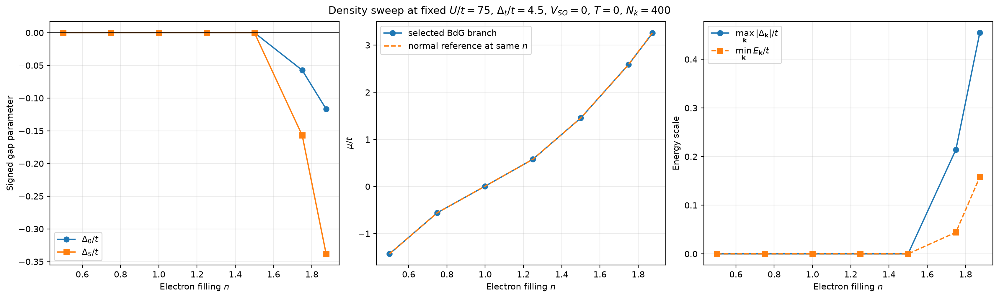
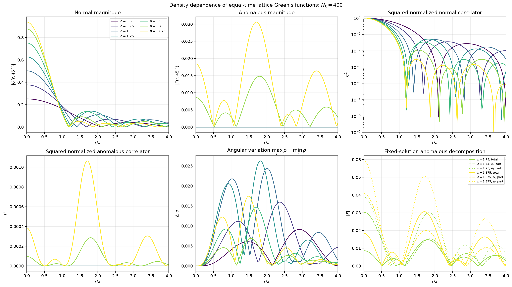
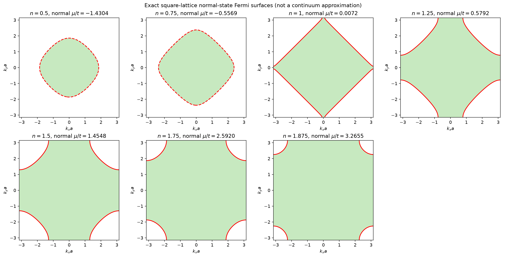
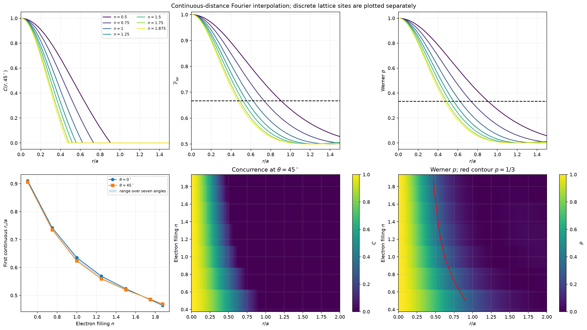
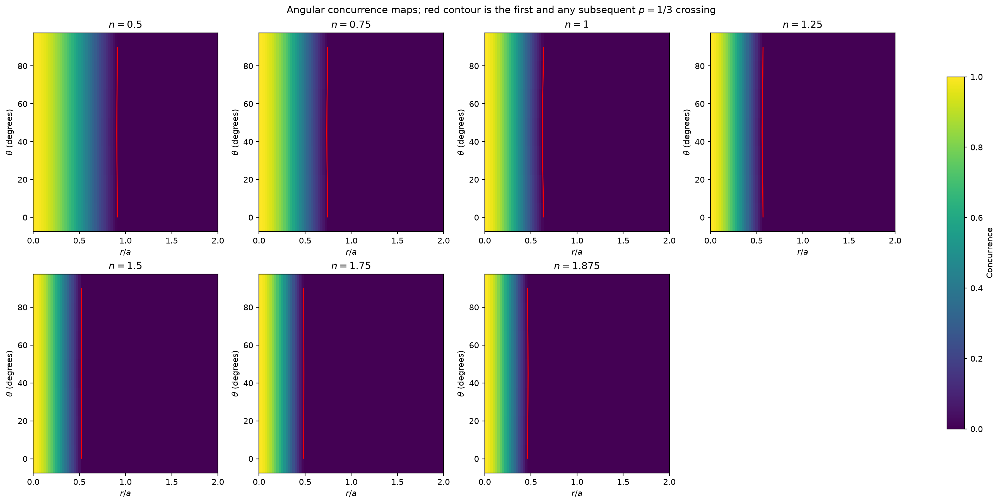
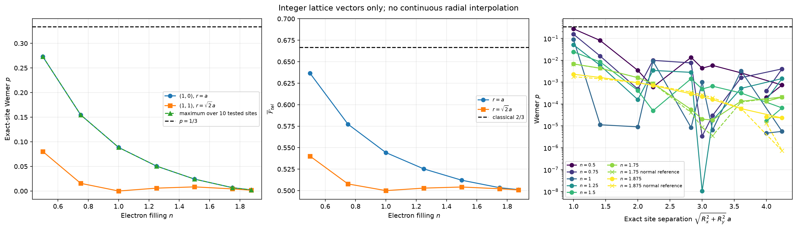
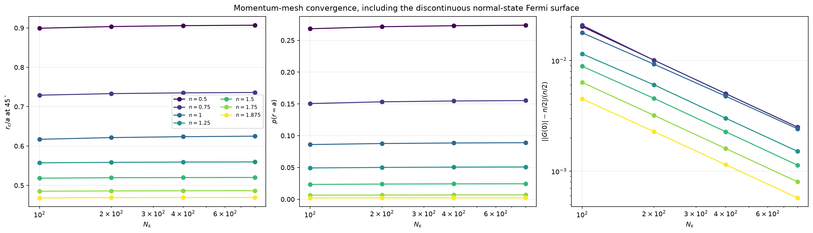

# Electron-density dependence of BdG correlations and teleportation

## Executive conclusion

At fixed \(U/t=75\), \(\Delta_t/t=4.5\), \(V_{\mathrm{SO}}=0\), and \(T=0\),
the seven requested fillings do **not** produce a finite-site teleportation
advantage. Lowering density systematically strengthens and lengthens the
normal-exchange contribution, but it also removes the nonzero-gap
self-consistent solution at \(n\leq1.5\). The best sampled density is
\(n=0.5\), for which the continuous Fourier-interpolated threshold reaches
\(r_c/a=0.905807\) at \(45^\circ\) (\(0.906945\) at \(N_k=800\)), while the
actual nearest-neighbor site has

\[
p=0.273016,\qquad C=0,\qquad
\overline{\mathcal F}_{\rm tel}=0.636508<2/3.
\]

Thus **high filling is a major cause of the short normal-correlation and
entanglement range**, but it is not the only obstacle to operational lattice
teleportation. Even the lowest sampled density remains below threshold at
\(r=a\). No tested nonzero lattice vector at any density has nonzero
concurrence.

Only \(n=1.75\) and \(1.875\) have reproducible nonzero-\((\Delta_0,\Delta_S)\)
stationary BdG branches. Their anomalous correlations modify the resource but
are far too small to restore finite-site advantage. These are converged
stationary solutions, not proven global free-energy minima.

---

## 1. Scope and exact model conventions

Only the filling was changed:

| Fixed quantity | Value |
|---|---:|
| Square-lattice hopping \(t\) | 1 |
| Hubbard interaction \(U/t\) | 75 |
| Correlated-hopping parameter \(\Delta_t/t\) | 4.5 |
| Spin–orbit coupling \(V_{\mathrm{SO}}/t\) | 0 |
| Temperature | 0 |
| Production momentum mesh | \(400\times400\) |
| Convergence meshes | \(100,200,400,800\) in each direction |
| Angles | \(0,15,30,45,60,75,90\) degrees |

The implemented dispersion and gap are

\[
\epsilon_{\mathbf k}=-2t(\cos k_x+\cos k_y),\qquad
\Delta_{\mathbf k}=\Delta_0-\frac{\Delta_S}{4t}\epsilon_{\mathbf k}
=\Delta_0+\Delta_Ss_{\mathbf k},
\]

with \(s_{\mathbf k}=(\cos k_x+\cos k_y)/2\). Energies below are reported in
units of \(t\), and distances in units of \(a\); the code uses \(t=a=1\).
Momenta are in radians per lattice constant.

The corrected equal-time functions are the lattice Fourier integrals of

\[
v_{\mathbf k}^2=\frac12\left(1-\frac{\epsilon_{\mathbf k}-\mu}{E_{\mathbf k}}
\right),\qquad
u_{\mathbf k}v_{\mathbf k}=\frac{\Delta_{\mathbf k}}{2E_{\mathbf k}},
\qquad
E_{\mathbf k}=\sqrt{(\epsilon_{\mathbf k}-\mu)^2+\Delta_{\mathbf k}^2}.
\]

The two degenerate helicity branches are averaged with the required factor
\(1/2\). A batched evaluator was used only after direct comparison with
`greens_functions.compute_greens_functions`; the maximum absolute difference
was \(4.04\times10^{-15}\).

### Continuous distance versus lattice sites

The continuous curves evaluate the lattice Fourier integral at arbitrary
\(r/a\). They are useful diagnostics but do not define additional electron
sites at sub-lattice positions. Exact-site results were therefore computed
separately at integer vectors

\[
(1,0),(1,1),(2,0),(2,1),(2,2),
(3,0),(3,1),(3,2),(3,3),(4,0).
\]

No radial-grid nearest-neighbor approximation was used for these points.

---

## 2. Self-consistent solutions and their interpretation

### Production solutions at \(N_k=400\)

| \(n\) | Branch | \(\Delta_0/t\) | \(\Delta_S/t\) | \(\mu/t\) | \(\max_{\mathbf k}|\Delta_{\mathbf k}|/t\) | \(\min_{\mathbf k}E_{\mathbf k}/t\) |
|---:|---|---:|---:|---:|---:|---:|
| 0.500 | normal, zero gap | 0 | 0 | -1.430404 | 0 | — |
| 0.750 | normal, zero gap | 0 | 0 | -0.556922 | 0 | — |
| 1.000 | normal, zero gap | 0 | 0 | +0.007237 | 0 | — |
| 1.250 | normal, zero gap | 0 | 0 | +0.579179 | 0 | — |
| 1.500 | normal, zero gap | 0 | 0 | +1.454846 | 0 | — |
| 1.750 | nonzero-gap stationary BdG | -0.05735485 | -0.15698674 | +2.589371 | 0.214337 | 0.044237 |
| 1.875 | nonzero-gap stationary BdG | -0.11664609 | -0.33815490 | +3.256205 | 0.454791 | 0.158066 |

The maximum residual on every production branch is below \(9\times10^{-12}\).
The discrete occupations computed from \(v_{\mathbf k}^2\) reproduce the target
filling. At half filling the finite-mesh chemical potential approaches zero as
the mesh is refined: \(\mu/t=0.033050,0.015833,0.007237,0.003391\) for
\(N_k=100,200,400,800\). Forcing \(\mu=0\) on an even finite grid would not
necessarily give exactly half filling because that grid need not contain an
exact Fermi-contour momentum.

Six independent solver seeds at \(N_k=100\), including the solver's own
restarts, gave:

- no accepted nonzero-gap root at \(n=0.5,0.75,1.0,1.25,1.5\);
- six identical nonzero-gap roots at each of \(n=1.75,1.875\), with zero
  displayed variation in \((\Delta_0,\Delta_S,\mu)\) at floating precision.

For zero-gap states, degenerate Fermi-shell members were assigned the exact
\(T=0\) coherence factor \(v_{\mathbf k}^2=1/2\), avoiding arbitrary signs from
roundoff. At \(N_k=100\), the fillings \(n=0.75\) and \(1.25\) are not exactly
representable by the zero-gap occupation steps; their \(4\times10^{-4}\) filling
residuals are retained in the convergence record. The production and
\(N_k=800\) states have exact target filling on their meshes.

### Stability boundary

Small residuals, positive quasiparticle energies on the paired branches, mesh
convergence, and seed reproducibility establish **numerically stationary BdG
solutions**. They do not establish global thermodynamic stability or exclude
phase coexistence, other order parameters, or a non-Gaussian ground state. No
free-energy comparison is claimed. Consequently, the lower-density result is
“only the zero-gap stationary branch was found,” not a proof that no paired
state can exist under every possible generalization.

The appearance of the nonzero-gap solution only at high electron filling is
consistent with the correlated-hopping mechanism in the base model's reference:
Hutchinson, Hirsch, and Marsiglio emphasize superconductivity generated by this
interaction at high electron (low hole) densities
([arXiv:1801.08988](https://arxiv.org/abs/1801.08988)).



---

## 3. Normal and anomalous Green's functions

### Numerical observations

1. **Normal correlator:** the central \(|G(r,\theta)|\) lobe broadens as \(n\)
   decreases. Its oscillation nodes and secondary lobes move outward, and the
   nearest-neighbor normalized normal weight \(g^2(a)\) increases from
   \(3.3998\times10^{-3}\) at \(n=1.875\) to \(0.428928\) at \(n=0.5\).
2. **Anomalous correlator:** \(F\) is exactly zero on the five selected
   zero-gap branches. It is nonzero only at \(n=1.75,1.875\), with
   \[
   |F(0)|=0.00859544\quad(n=1.75),\qquad
   |F(0)|=0.01842352\quad(n=1.875).
   \]
   It has pronounced spatial lobes and nodes, so pairing does not produce a
   monotonic real-space envelope.
3. **Normalization:** \(G(0)\) remains close to \(n/2\), as required by the
   single-spin equal-time convention. The largest production Simpson-quadrature
   relative deviation is \(0.5019\%\) at \(n=0.5\); it decreases with mesh
   refinement. The discrete occupation sum itself matches \(n/2\).
4. **Anisotropy:** the maximum angular spread
   \(\max_\theta p-\min_\theta p\) over the calculated radial range is
   \(0.00912,0.01595,0.02417,0.02626,0.01470,0.00691,0.01745\) as \(n\)
   increases through the seven values. Angular structure is visible in the
   correlators, but the first threshold is only weakly angle dependent.

### On-site and extended-\(s\) contributions

For a fixed self-consistent solution, the anomalous Fourier weight can be
linearly decomposed into parts proportional to \(\Delta_0/(2E_{\mathbf k})\)
and \(\Delta_Ss_{\mathbf k}/(2E_{\mathbf k})\). This is a decomposition of the
same solution, not two separately re-solved Hamiltonians. At the origin:

| \(n\) | Total \(|F(0)|\) | On-site part | Extended-\(s\) part |
|---:|---:|---:|---:|
| 1.750 | 0.008595 | 0.030275 | 0.038871 |
| 1.875 | 0.018424 | 0.040811 | 0.059235 |

The two parts interfere destructively at the origin. Their spatial
interference changes the anomalous lobes and nodes. The extended-\(s\) bond
range therefore must not be equated with a large net anomalous correlator or a
finite-site entanglement range.



### Fermi-surface interpretation

The exact lattice Fermi-surface contours explain the normal-correlation trend:

- at low \(n\), the occupied pocket is electron-like around \(\Gamma\);
- at \(n=1\), the contour is the half-filled square-lattice van Hove geometry;
- above half filling, a hole description around \((\pi,\pi)\) becomes natural;
- at \(n=1.875\), only a small hole pocket remains.

The short real-space period associated with the high-momentum hole pocket and
the small unoccupied fraction suppress long-range normal exchange at high
filling. No circular-continuum \(k_F\) approximation was used in the numerical
calculation.



For a zero-gap nonzero lattice vector, the discrete filling identity gives the
rigorous bound

\[
|g(\mathbf R)|\leq \frac{\min(n,2-n)}{n},\qquad f=0.
\]

This becomes increasingly restrictive above half filling and gives
\(|g|\leq1/15\) at \(n=1.875\). The finite-pairing calculation must be evaluated
numerically, but the bound identifies the normal-state filling mechanism.

---

## 4. Concurrence, Werner parameter, and teleportation fidelity

The implemented conditional state is Werner with

\[
g^2=\frac{|G(r)|^2}{|G(0)|^2},\qquad
f^2=\frac{|F(r)|^2}{|G(0)|^2},\qquad
p=\frac{g^2+f^2}{2+f^2-g^2}.
\]

For the initial resource,

\[
C=\max\left(0,\frac{3p-1}{2}\right),\qquad
\overline{\mathcal F}_{\rm tel}=\frac{1+p}{2}.
\]

The fixed singlet-reference and locally optimized standard-protocol fidelities
coincide for these initial Werner states. The advantage condition is exactly

\[
\overline{\mathcal F}_{\rm tel}>2/3
\iff p>1/3
\iff 2g^2+f^2>1
\iff C>0.
\]

### Continuous Fourier-interpolated thresholds

| \(n\) | \(r_c/a\), \(0^\circ\), \(N_k=400\) | \(r_c/a\), \(45^\circ\), \(N_k=400\) | \(r_c/a\), \(45^\circ\), \(N_k=800\) |
|---:|---:|---:|---:|
| 0.500 | 0.910501 | 0.905807 | 0.906945 |
| 0.750 | 0.742126 | 0.735026 | 0.736053 |
| 1.000 | 0.635639 | 0.623743 | 0.625024 |
| 1.250 | 0.569084 | 0.559243 | 0.559601 |
| 1.500 | 0.523969 | 0.519899 | 0.520134 |
| 1.750 | 0.484385 | 0.486307 | 0.486497 |
| 1.875 | 0.464193 | 0.469159 | 0.469316 |

The \(45^\circ\) threshold increases monotonically as density decreases over
this sampled set. At every density, \(C=1\) and
\(\overline{\mathcal F}_{\rm tel}=1\) at the mathematical coincident point
\(r=0\). Concurrence is clipped to zero after the first threshold loss, while
\(p\) and fidelity continue to show smaller oscillatory structure.

No upward threshold re-crossing was found after the first loss at any of the
seven angles out to \(r=10a\). Thus no spatial concurrence revival was observed
in this density sweep. The largest post-loss \(p\) remained below \(1/3\) for
every curve.





---

## 5. Exact lattice-site results

All 70 nonzero-site states—ten vectors at each of seven densities—have \(C=0\).
The largest exact-site \(p\) at every density occurs at \((1,0)\).

| \(n\) | \(p(a)\) | \(\overline{\mathcal F}_{\rm tel}(a)\) | \(p(\sqrt2a)\) | \(\overline{\mathcal F}_{\rm tel}(\sqrt2a)\) | Maximum \(C\) at tested sites |
|---:|---:|---:|---:|---:|---:|
| 0.500 | 0.27301585 | 0.63650792 | 0.08021108 | 0.54010554 | 0 |
| 0.750 | 0.15462442 | 0.57731221 | 0.01558261 | 0.50779131 | 0 |
| 1.000 | 0.08855379 | 0.54427690 | 0.00001129 | 0.50000565 | 0 |
| 1.250 | 0.05057319 | 0.52528660 | 0.00583138 | 0.50291569 | 0 |
| 1.500 | 0.02422353 | 0.51211176 | 0.00840476 | 0.50420238 | 0 |
| 1.750 | 0.00681653 | 0.50340827 | 0.00434355 | 0.50217177 | 0 |
| 1.875 | 0.00229876 | 0.50114938 | 0.00163949 | 0.50081974 | 0 |

At \(n=0.5\), the nearest-neighbor values are

\[
g^2=0.428928,\qquad f^2=0,\qquad 2g^2+f^2=0.857855<1.
\]

Hence the failure is not marginal at the level of the exact Werner threshold.
At \(n=1.875\), the anomalous term is relatively more visible,

\[
g^2(a)=0.00339978,\qquad f^2(a)=0.00119267,
\]

but their threshold combination remains only \(0.00799223\), far below one.

These results cover the listed tested vectors, not a mathematical proof for
every arbitrarily distant integer vector. The absence of any later continuous
threshold crossing at the seven sampled angles out to \(10a\) provides an
additional, but distinct, numerical check.



---

## 6. Pairing versus filling: controlled comparisons

Two different diagnostics were kept separate:

1. **Normal-only formula diagnostic:** set \(f=0\) in the Werner expression
   while retaining the paired \(v_{\mathbf k}^2\).
2. **Normal-reference state:** solve the zero-gap number equation at the same
   filling and recompute both Green's functions.

Neither is an independently re-solved on-site-only or extended-\(s\)-only
counterfactual.

At \(n=1.75\), the maximum absolute difference between the full and
normal-only \(p\) on the fine \(0,45^\circ\) grids is \(1.7881\times10^{-4}\).
At \(n=1.875\), it is \(6.7282\times10^{-4}\). The direct anomalous term is
therefore small compared with the threshold distance to \(p=1/3\).

The same-filling normal-reference comparison gives:

| Quantity | \(n=1.75\) | \(n=1.875\) |
|---|---:|---:|
| Paired \(p(a)\) | 0.00681653 | 0.00229876 |
| Normal-reference \(p(a)\) | 0.00670084 | 0.00176113 |
| Paired \(r_c/a\), \(45^\circ\) | 0.486307 | 0.469159 |
| Normal-reference \(r_c/a\), \(45^\circ\) | 0.486381 | 0.469551 |

Pairing enhances nearest-neighbor \(p\) in these two cases—by about \(30.6\%\)
relative to the normal reference at \(n=1.875\)—but the absolute value remains
very small. The continuous critical radius is essentially unchanged or
slightly reduced. Pairing redistributes and supplements correlations; it does
not create a longer operational range here.

The lower-density increase in teleportation fidelity is therefore primarily a
**normal-exchange/Fermi-surface effect**, not evidence of stronger
superconducting pairing. Indeed, the nonzero-gap solution disappears at the
lower sampled densities.

---

## 7. Numerical verification

The independent validator reports **78/78 passed checks** in
`reports/density_study_validation.json`. It checks:

- finite arrays and physical ranges;
- the Werner, concurrence, and teleportation identities;
- exact-site and continuous-grid consistency;
- \(C(0)=F_{\rm tel}(0)=1\);
- square-lattice angular symmetries;
- zero anomalous functions on zero-gap branches;
- the normal-state exact-site occupancy bound;
- production residuals and discrete filling;
- multistart reproducibility and explicit stability limitations;
- independent critical-radius interpolation;
- absence of post-loss threshold regain;
- positivity and normalization of sampled physical states;
- agreement of fixed and optimized explicit teleportation protocols;
- presence of all numerical artifacts and figures.

The fixed and optimized explicit protocol formulas agreed with the analytic
Werner identities within \(6.7\times10^{-16}\) over 196 sampled states. The
repository density-matrix constructor agreed with the explicit Werner matrix
within \(2.3\times10^{-16}\).

### Momentum-mesh uncertainty

The maximum \(400\to800\) change in \(r_c/a\) is \(0.001281\), at half filling;
the next largest is \(0.001138\) at \(n=0.5\). The maximum corresponding
nearest-site \(p\) change is below \(0.0008\). Normal-state Fermi-surface
discontinuities make raw \(|G(0)|\) quadrature converge more slowly than the
paired-state quantities, but the normalized threshold conclusions are stable.



---

## 8. Final physical answer

- **Superconducting pairing:** within the solved stationary BdG equations,
  nonzero on-site and extended-\(s\) parameters appear only at the two highest
  sampled fillings and grow strongly toward \(n=1.875\).
- **Electron correlations:** decreasing \(n\) broadens the normal correlation
  lobe and shifts its oscillations outward. Anomalous correlations exist only
  on the two paired branches and display their own interference lobes.
- **Entanglement and teleportation:** lower \(n\) gives stronger finite-\(r\)
  normal-exchange entanglement and higher continuous-distance fidelity, but
  the advantage remains below the nearest lattice site for all sampled \(n\).
- **Role of \(n=1.875\):** the nearly filled band strongly suppresses normal
  exchange through its small hole fraction and high-momentum hole Fermi
  surface. It is therefore a major reason for the previously observed short
  range. Pairing at this filling does not compensate for that suppression.
- **Best sampled density:** \(n=0.5\) provides the strongest nearest-site
  resource and the longest continuous threshold, but still has \(C(a)=0\) and
  \(\overline{\mathcal F}_{\rm tel}(a)=0.636508\).
- **Maximum physically meaningful separation:** no nonzero allowed lattice
  separation with teleportation advantage was found. The coincident \(r=0\)
  singlet is a mathematical/onsite property and does not by itself supply two
  independently addressable spatially separated A/B modes. Continuous values
  such as \(r_c/a=0.906\) must not be relabeled as physical sub-lattice
  detector separations without an intra-cell orbital model.

---

## 9. Reproduction and artifacts

From the repository root:

```bash
.venv/bin/python analysis/run_density_teleportation_study.py
.venv/bin/python analysis/validate_density_study.py
```

The study writes only density-specific files and does not overwrite the
archived microscopic or manuscript datasets:

- `data/density_teleportation_spatial.npz`
- `data/density_teleportation_convergence.npz`
- `reports/density_teleportation_summary.json`
- `reports/density_study_validation.json`
- seven `figs/density_*.png` figures listed in the JSON summary.

The JSON summary is the authoritative record for solver seeds, residuals,
finite-mesh filling caveats, convergence values, all exact-site results, and
interpretation boundaries.
