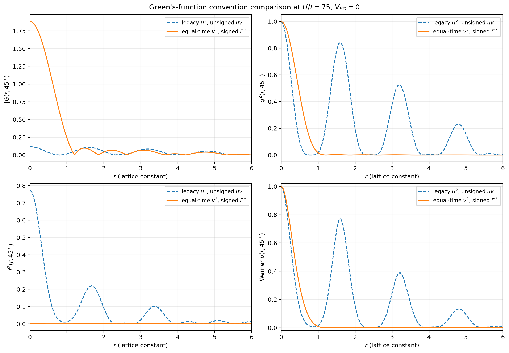
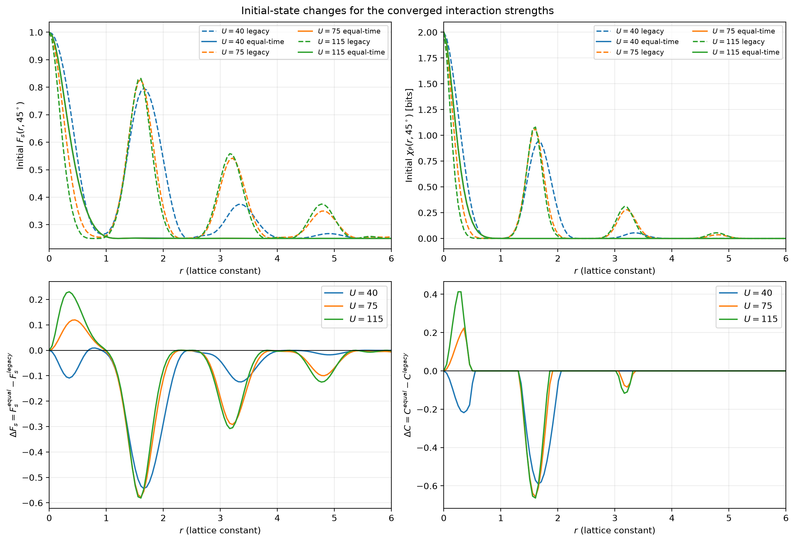
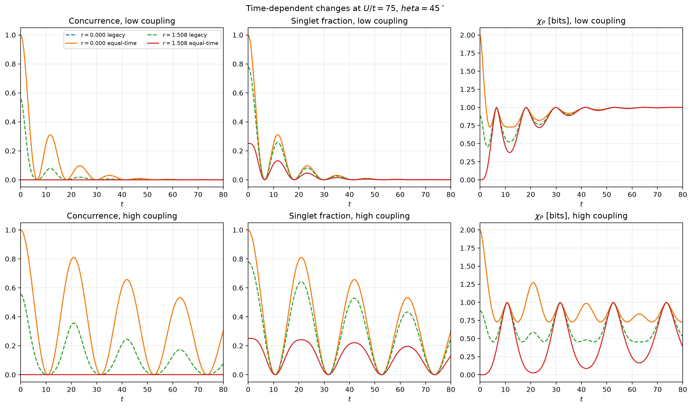

# Equal-time Green’s-function correction: numerical comparison

## Scope and bottom line

The default Green’s-function implementation has been changed to the zero-temperature equal-time branch required for the Oh–Kim density-matrix reduction:

\[
G_<(\mathbf r)=+i\sum_{\mathbf k,s}|v_{\mathbf ks}|^2e^{-i\mathbf k\cdot\mathbf r},
\qquad
F^*_<(\mathbf r)=+i\sum_{\mathbf k,s}u_{\mathbf ks}^*v_{\mathbf ks}e^{-i\mathbf k\cdot\mathbf r},
\]

with \(\hbar=1\) and, in Ketterson’s BdG convention,

\[
u_{\mathbf ks}^*v_{\mathbf ks}=\frac{\Delta_{\mathbf ks}^*}{2E_{\mathbf ks}}.
\]

The previous implementation remains available as `convention="legacy_unsigned"`. The archived manuscript arrays have not been overwritten.

**The numerical results change substantially.** The correction preserves the zero-separation singlet and its exact amplitude-damping identity, but it removes the large finite-separation entanglement revivals and Holevo advantages previously obtained at several highlighted points. The manuscript must therefore be regenerated before its numerical conclusions can be defended.

## Implemented equations

For `phase = exp(i*k.r)` and `r = r1-r2`, the new default evaluates

```python
sumG += 1j * np.abs(v)**2 * np.conj(phase)
sumF += 1j * (np.conj(Delta_ks) / (2.0 * E_ks)) * np.conj(phase)
```

The anomalous line implements \(u^*v=\Delta^*/(2E)\) while retaining the gap sign before Brillouin-zone integration. The legacy option preserves the old lines exactly for reproduction.

The calculation remains restricted to the archived \(V_{\mathrm{SO}}=0\) original-spin reduction. It does not solve the separate nonzero-Rashba spin-basis problem.

## Validation

- All three self-consistent solutions converged: \(U/t=40,75,115\).
- Legacy \(U/t=75\) Green’s functions reproduce the archived arrays with maximum absolute errors \(7.65\times10^{-17}\) for \(G\) and \(1.53\times10^{-16}\) for \(F\).
- All generated density matrices are Hermitian, unit trace, and positive semidefinite.
- The occupied-state sum rule gives \(|G_<(0)|\approx n=1.875\). The numerical values are 1.881343, 1.883450, and 1.883685 for \(U/t=40,75,115\), with relative quadrature errors of 0.34–0.46%.
- For every interaction and both amplitude-damping regimes, the corrected zero-separation state satisfies
  \[
  F_{\mathrm s}(0,t)=C(0,t)=p(t)
  \]
  to zero reported floating-point error.
- At \(r=0\), both conventions give \(F_{\mathrm s}=C=1\) and \(\chi_{\mathrm P}=2\) bits initially.

## Maximum changes over the full angular/radial grid

These are initial-state changes; the full time-dependent maxima are identical because the time grids include \(t=0\).

| \(U/t\) | \(\max|\Delta p|\) | \(\max|\Delta F_{\mathrm s}|\) | \(\max|\Delta C|\) | \(\max|\Delta\chi_{\mathrm P}|\) (bits) |
|---:|---:|---:|---:|---:|
| 40 | 0.799169 | 0.599377 | 0.710769 | 1.174346 |
| 75 | 0.852750 | 0.639563 | 0.781441 | 1.329052 |
| 115 | 0.875693 | 0.656770 | 0.814730 | 1.407971 |

The maxima measure the largest absolute discrepancy over all seven angles and 200 separations; they do not occur at every point.

## Representative finite-separation results

At \(\theta=45^\circ\) and \(r=1.507537688\):

| \(U/t\) | Convention | \(F_{\mathrm s}(0)\) | \(C(0)\) | \(\chi_{\mathrm P}(0)\) (bits) |
|---:|---|---:|---:|---:|
| 40 | legacy | 0.717745 | 0.435490 | 0.694131 |
| 40 | equal-time | 0.251602 | 0 | \(9.86\times10^{-6}\) |
| 75 | legacy | 0.778551 | 0.557102 | 0.886208 |
| 75 | equal-time | 0.251301 | 0 | \(6.50\times10^{-6}\) |
| 115 | legacy | 0.783515 | 0.567031 | 0.903183 |
| 115 | equal-time | 0.251027 | 0 | \(4.05\times10^{-6}\) |

At the previously highlighted point \(U/t=75\), \(r=1.608040201\), \(\theta=45^\circ\):

- legacy: \(F_{\mathrm s}=0.828577\), \(C=0.657153\), \(\chi_{\mathrm P}=1.067350\) bits;
- equal-time: \(F_{\mathrm s}=0.251071\), \(C=0\), \(\chi_{\mathrm P}=4.41\times10^{-6}\) bits.

Thus the previously reported above-one-bit Holevo advantage at this point is **not preserved**.

The previously highlighted interaction-order reversal between \(r=0.502513\) and \(r=1.507538\) is also not preserved in the new calculation. At both separations, the corrected initial values have the ordering \(U/t=40>75>115\) for \(F_{\mathrm s}\) and \(\chi_{\mathrm P}\). This statement concerns these two tested points; it is not a claim that no ordering reversal occurs anywhere else.

## Figures

### Green’s functions and normalized correlators



The normal occupation correlator has a much larger \(G(0)\) and decays without the large finite-\(r\) normalized oscillations produced by the legacy \(u^2\) normalization. Both \(g\) and \(f\) enter the density matrix, and both are normalized by the same \(G(0)\).

### Initial-state interaction comparison



The large finite-\(r\) singlet-fraction peaks and concurrence regions are strongly suppressed in the corrected calculation. Small residual interaction dependence remains and must be analyzed from the new arrays rather than inferred from the old figures.

### Time evolution in both noise regimes



At \(r=0\), legacy and corrected curves coincide exactly. At \(r\approx1.508\), the corrected initial singlet fraction is close to 0.25, concurrence remains zero in the displayed calculation, and the Pauli-ensemble Holevo quantity starts near zero before approaching the known long-time amplitude-damped limit. The two noise regimes retain their distinct dynamics.

## Scientific consequences

1. **Oh–Kim’s matrix algebra is not the source of the discrepancy.** The problem was the time-ordering branch and anomalous phase used as its microscopic input.
2. **The old manuscript figures cannot be mixed with the new default outputs.** They represent different normal correlators and different normalizations.
3. **The previous strong finite-\(r\) entanglement, above-one-bit Holevo point, and specific \(U\)-ordering reversal require retraction or recomputation.** They are not supported by the corrected equal-time calculation.
4. **The exact zero-separation results survive.** In particular, \(F_{\mathrm s}=C=p(t)\) and the long-time \(\chi_{\mathrm P}\to1\)-bit limit remain valid.
5. **A complete manuscript regeneration is required**, including angular plots, both noise regimes, the interaction sweep, supporting reports, and all numerical statements.

## Reproduction

```bash
.venv/bin/python analysis/compare_equal_time_greens.py
```

Artifacts:

- `data/equal_time_vs_legacy_comparison.npz` — complete initial radial profiles and selected time-dependent slices;
- `reports/equal_time_vs_legacy_summary.json` — solver, sum-rule, positivity, and numerical-difference records;
- `reports/equal_time_vs_legacy_stdout.txt` — execution summary;
- `figs/equal_time_greens_comparison_U75.png`;
- `figs/equal_time_initial_U_comparison.png`;
- `figs/equal_time_dynamics_U75.png`.

No result in this report is inferred from a configuration file alone: all arrays were generated by executing the comparison script after the code correction.
