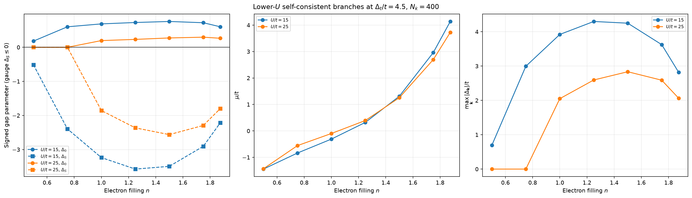
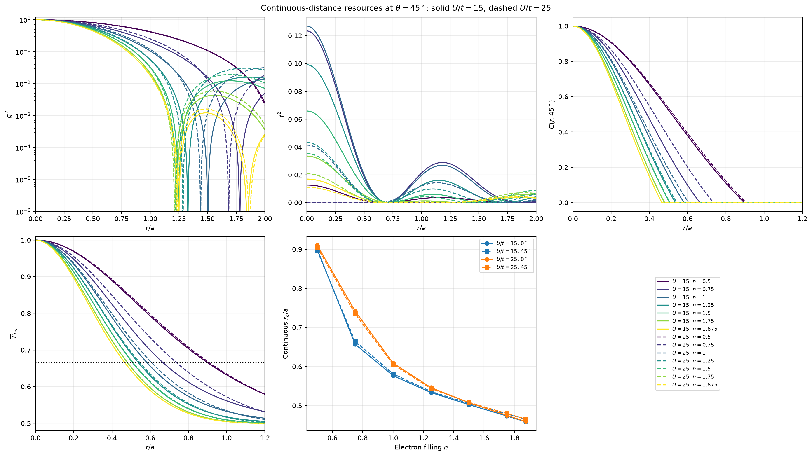
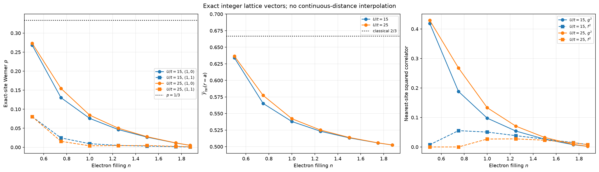
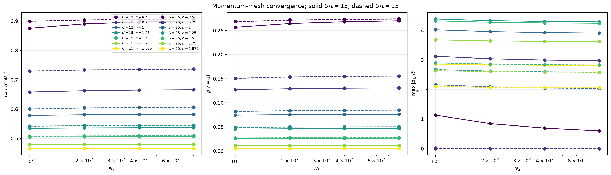

# Lower-interaction density study: \(U/t=15\) and \(25\)

## Purpose and fixed parameters

This study extends the earlier \(U/t=75\) density analysis to

\[
\boxed{U/t=15\quad\text{and}\quad U/t=25.}
\]

The correlated-hopping interaction is unchanged,

\[
\boxed{\Delta_t/t=4.5,}
\]

as are \(V_{\mathrm{SO}}=0\), \(T=0\), the square-lattice dispersion, the
on-site plus extended-\(s\) gap, and the corrected equal-time Green's-function
convention. The seven fillings are \(n=0.5,0.75,1.0,1.25,1.5,1.75,1.875\).
The production mesh is \(400\times400\), with \(100,200,400,800\) convergence
comparisons and six solver seeds at \(N_k=100\).

The irrelevant overall sign of the gap is fixed by choosing \(\Delta_S\leq0\).
Changing both \((\Delta_0,\Delta_S)\) to \((-\Delta_0,-\Delta_S)\) leaves the
physical resource magnitudes unchanged.

## Main answer

Lowering \(U\) changes the stationary pairing solutions dramatically:

- **At \(U/t=15\), a nonzero-gap solution was found at every sampled density.**
- **At \(U/t=25\), \(n=0.5\) and \(0.75\) are zero-gap on the production and
  finest meshes, while \(n=1.0\) through \(1.875\) have nonzero-gap branches.**
- A very small paired root at \(U/t=25,n=0.75,N_k=100\) disappears at
  \(N_k=200,400,800\); it is mesh-dependent and is not presented as robust
  superconductivity.
- **No tested nonzero lattice site reaches nonzero concurrence or teleportation
  fidelity above \(2/3\), at either interaction.**

Thus, obtaining a large superconducting order parameter at low density does not
automatically produce useful finite-site teleportation.

---

## 1. Self-consistent production solutions

| \(U/t\) | \(n\) | \(\Delta_0/t\) | \(\Delta_S/t\) | \(\mu/t\) | \(\max_{\mathbf k}|\Delta_{\mathbf k}|/t\) |
|---:|---:|---:|---:|---:|---:|
| 15 | 0.500 | +0.181123 | -0.512376 | -1.443074 | 0.693499 |
| 15 | 0.750 | +0.600845 | -2.393505 | -0.837215 | 2.994351 |
| 15 | 1.000 | +0.686216 | -3.234806 | -0.309485 | 3.921022 |
| 15 | 1.250 | +0.727005 | -3.572029 | +0.321745 | 4.299034 |
| 15 | 1.500 | +0.757316 | -3.491605 | +1.310577 | 4.248920 |
| 15 | 1.750 | +0.720193 | -2.904189 | +2.962452 | 3.624382 |
| 15 | 1.875 | +0.601116 | -2.215107 | +4.137529 | 2.816223 |
| 25 | 0.500 | 0 | 0 | -1.430404 | 0 |
| 25 | 0.750 | 0 | 0 | -0.556922 | 0 |
| 25 | 1.000 | +0.196566 | -1.854346 | -0.098078 | 2.050913 |
| 25 | 1.250 | +0.231641 | -2.363357 | +0.393635 | 2.594998 |
| 25 | 1.500 | +0.274079 | -2.561070 | +1.256200 | 2.835149 |
| 25 | 1.750 | +0.296515 | -2.291915 | +2.696877 | 2.588431 |
| 25 | 1.875 | +0.264617 | -1.798159 | +3.724770 | 2.062776 |

Every selected production solution satisfies the target discrete filling and
has maximum self-consistency residual below \(6.3\times10^{-10}\).

The \(U/t=15\) gaps are large compared with the hopping scale, particularly at
intermediate filling. Weak-coupling BCS intuition should therefore not be
applied uncritically. The calculations establish reproducible stationary
mean-field branches, not global thermodynamic ground states. No free-energy
comparison or proof against competing orders is included.



---

## 2. Continuous-distance and exact-site resources

For the conditional Werner state,

\[
p=\frac{g^2+f^2}{2+f^2-g^2},\qquad
C=\max\left(0,\frac{3p-1}{2}\right),\qquad
\overline{\mathcal F}_{\rm tel}=\frac{1+p}{2}.
\]

The advantage condition remains \(p>1/3\). Continuous \(r_c\) values below are
Fourier interpolations, not physical sub-lattice sites. Exact-site values are
evaluated at integer lattice vectors.

| \(U/t\) | \(n\) | \(r_c/a\), \(45^\circ\), \(N_k=400\) | \(N_k=800\) | \(f^2(a)\) | \(p(a)\) | \(\overline{\mathcal F}_{\rm tel}(a)\) |
|---:|---:|---:|---:|---:|---:|---:|
| 15 | 0.500 | 0.896729 | 0.900066 | 0.007581 | 0.268080 | 0.634040 |
| 15 | 0.750 | 0.664634 | 0.665807 | 0.055339 | 0.130355 | 0.565177 |
| 15 | 1.000 | 0.581330 | 0.581893 | 0.050471 | 0.075884 | 0.537942 |
| 15 | 1.250 | 0.536287 | 0.536610 | 0.038341 | 0.046447 | 0.523224 |
| 15 | 1.500 | 0.505851 | 0.506049 | 0.026540 | 0.026529 | 0.513264 |
| 15 | 1.750 | 0.479129 | 0.479252 | 0.014815 | 0.011185 | 0.505593 |
| 15 | 1.875 | 0.465440 | 0.465519 | 0.008027 | 0.005023 | 0.502512 |
| 25 | 0.500 | 0.905807 | 0.906945 | 0 | 0.273016 | 0.636508 |
| 25 | 0.750 | 0.735026 | 0.736053 | 0 | 0.154624 | 0.577312 |
| 25 | 1.000 | 0.605579 | 0.606498 | 0.026865 | 0.084440 | 0.542220 |
| 25 | 1.250 | 0.543882 | 0.544288 | 0.027418 | 0.050022 | 0.525011 |
| 25 | 1.500 | 0.508550 | 0.508785 | 0.022864 | 0.027726 | 0.513863 |
| 25 | 1.750 | 0.479927 | 0.480072 | 0.014182 | 0.011450 | 0.505725 |
| 25 | 1.875 | 0.465810 | 0.465905 | 0.007915 | 0.005098 | 0.502549 |

All tabulated exact nearest-neighbor states have \(C=0\). The diagonal
\((1,1)\) results and eight additional vectors per case are stored in the NPZ
and JSON artifacts. Across two interactions, seven densities, and ten nonzero
vectors—**140 production states**—none exceeds \(p=1/3\). The same conclusion
holds on all four convergence meshes.

The strongest exact-site result remains the zero-gap state at
\(U/t=25,n=0.5,(1,0)\):

\[
p=0.273016,\qquad C=0,\qquad
\overline{\mathcal F}_{\rm tel}=0.636508.
\]





---

## 3. Why larger anomalous correlations do not give advantage

The lower-\(U\) paired solutions generate much larger \(f^2(a)\) than the
\(U/t=75\) high-filling solution. Nevertheless, the threshold depends on the
combination

\[
2g^2(a)+f^2(a)>1,
\]

not on \(f^2\) alone. Pairing also changes the normal occupation
\(v_{\mathbf k}^2\), and hence \(G(r)\), and the extended-\(s\) and on-site
anomalous Fourier contributions interfere.

A same-filling zero-gap reference isolates the total effect of the selected
paired branch:

| \(U/t\) | \(n\) | Normal-reference \(p(a)\) | Paired \(p(a)\) | Effect at \(r=a\) |
|---:|---:|---:|---:|---|
| 15 | 0.500 | 0.273016 | 0.268080 | decrease |
| 15 | 0.750 | 0.154624 | 0.130355 | decrease |
| 15 | 1.000 | 0.088554 | 0.075884 | decrease |
| 15 | 1.250 | 0.050573 | 0.046447 | decrease |
| 15 | 1.500 | 0.024224 | 0.026529 | increase |
| 15 | 1.750 | 0.006701 | 0.011185 | increase |
| 15 | 1.875 | 0.001761 | 0.005023 | increase |
| 25 | 1.000 | 0.088554 | 0.084440 | decrease |
| 25 | 1.250 | 0.050573 | 0.050022 | small decrease |
| 25 | 1.500 | 0.024224 | 0.027726 | increase |
| 25 | 1.750 | 0.006701 | 0.011450 | increase |
| 25 | 1.875 | 0.001761 | 0.005098 | increase |

Even where pairing increases \(p(a)\), the absolute value remains far below
\(1/3\). At \(U/t=15,n=0.75\), for example, \(f^2(a)=0.05534\) is substantial
compared with the earlier high-\(U\) values, but the normal contribution and
threshold combination still give only \(p(a)=0.13035\).

At \(45^\circ\), every nonzero-gap lower-\(U\) production branch has a slightly
or substantially **shorter** first continuous threshold than its same-filling
normal reference. This is another demonstration that anomalous correlations
and operational entanglement range are not interchangeable.

No upward concurrence-threshold regain was found after the first loss at any
of the seven sampled angles out to \(r=10a\), for either interaction.

---

## 4. Mesh convergence and numerical caveats

The largest \(400\to800\) change in \(r_c/a\) is \(0.003337\), at
\(U/t=15,n=0.5\). The corresponding maximum gap changes from \(0.69350\) to
\(0.60017\) between those meshes, so this case is not assigned a highly precise
continuum gap value. Its nearest-site conclusion remains unchanged:
\(p(a)=0.268080\) at \(N_k=400\) and \(0.270049\) at \(N_k=800\), still below
\(1/3\).

For every other lower-\(U\) case, the \(400\to800\) critical-radius change is
below \(0.00118\). The largest nearest-site \(p\) change across all cases is
below \(0.002\). No threshold conclusion changes with mesh refinement.

At \(U/t=25,n=0.75\), the coarse \(N_k=100\) root is

\[
\Delta_0/t=0.00278215,\qquad \Delta_S/t=-0.02034372,
\]

but the selected state is zero-gap at \(N_k=200,400,800\). This is explicitly a
mesh-dependent near-threshold solution, not evidence for a robust paired state.



The independent validator reports **64/64 passed checks**, including:

- self-consistency residuals and target occupations;
- six-seed reproducibility in the fixed gap gauge;
- Werner and origin-singlet identities;
- square-lattice angular symmetries;
- exact-site and all-mesh threshold checks;
- independent critical-radius interpolation;
- absence of post-loss threshold regain;
- explicit fixed and optimized teleportation protocol identities over 392
  sampled states;
- positivity and trace normalization;
- agreement of the batched Green's functions with the repository implementation
  within \(3.95\times10^{-15}\).

Global thermodynamic stability remains outside these numerical checks.

---

## 5. Comparison with the \(U/t=75\) conclusion

The earlier interaction produced nonzero gaps only at \(n=1.75,1.875\). The
new runs show that this was **not a universal statement about low density**:
at \(U/t=15\), every sampled density has a nonzero-gap stationary solution.

The three interactions also show why no monotonic “lower \(U\) is better” rule
should be inferred:

- lower \(U\) can enlarge the superconducting order parameter;
- it can either suppress or enhance nearest-site \(p\), depending on filling;
- the continuous entanglement window can shrink relative to the normal state;
- none of \(U/t=15,25,75\) yields an above-threshold nonzero lattice-site
  resource in the tested parameter set.

These are sampled interaction values, not a continuous phase diagram or proof
of monotonicity in \(U\).

---

## 6. Reproduction and artifacts

```bash
.venv/bin/python analysis/run_low_U_density_study.py
.venv/bin/python analysis/validate_low_U_density_study.py
```

Files:

- `data/low_U_density_teleportation.npz`
- `reports/low_U_density_summary.json`
- `reports/low_U_density_validation.json`
- `figs/low_U_density_bdg_solutions.png`
- `figs/low_U_density_resources.png`
- `figs/low_U_density_lattice_sites.png`
- `figs/low_U_density_convergence.png`

The earlier \(U/t=75\) arrays, figures, and reports are not overwritten.
